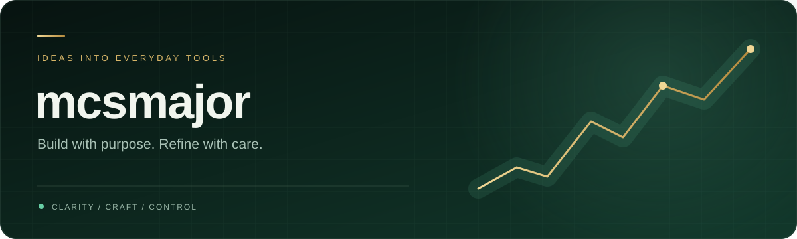

### Hi, I'm Chayutarat 👋

I build personal tools that turn complex, fast-moving information into something anyone can read at a glance — 
clean interfaces, systems you can verify, and decisions that stay in the user's hands.

ผมสร้างเครื่องมือที่ทำให้ข้อมูลซับซ้อนอ่านง่าย หน้าตาใช้งานคล่อง ระบบเบื้องหลังตรวจสอบได้ และผู้ใช้เป็นคนตัดสินใจเสมอ

---

### 🏆 Featured project

**[AITrading · Gold Market Desk](https://github.com/mcsmajor/AITrading-Showcase)** — a personal desk for spot gold (XAUUSD)
on macOS and the web. It reads the market top-down, draws zones and structure onto the live chart, and explains every step in plain
language for beginners. Read-only by design: the system explains, the trader decides.

| | |
| :--- | :--- |
| 🧭 **Market map** | Big picture → zone → turn → sweep → candle, each with *now / meaning / what to do* |
| ⚡ **Real-time** | MetaTrader 5 data in ~0.25 s on the Mac, seconds on the web |
| 🪞 **Two screens, one design** | Native SwiftUI app and a members-only web desk with the same layout |
| 🛡️ **Safe by design** | No order execution, no trading on stale data, evidence stored append-only |

  
  

The full source is kept private; the showcase repository shows the product, the architecture and the principles behind it.

---

**Build with purpose. Refine with care.**

Chayutarat Srioumsuk · mcsmajor · Thailand

